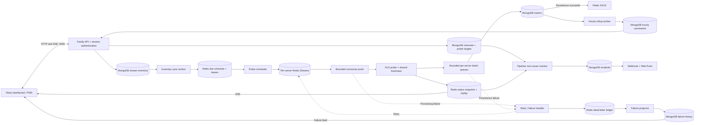

# HLS Monitor

A monitoring application for live HLS channels and their upstream signal paths. Operators can build channel topologies, inspect shared servers, identify failing hops, review availability reports and investigate processing failures.

**The React frontend and backend API run on the same port: `http://localhost:3000`.** Fastify serves the built frontend; a separate frontend server is optional during development.

## Contents

- [Quick start](#quick-start)
- [Software architecture](#software-architecture)
- [Source layout](#source-layout)
- [Technology stack](#technology-stack)
- [Pages and API](#pages-and-api)
- [Configuration](#configuration)
- [Data and retention](#data-and-retention)
- [Account and maintenance](#account-and-maintenance)
- [Testing](#testing)
- [Operations and troubleshooting](#operations-and-troubleshooting)

## Quick start

Use Node.js 24 and npm for local builds. The supplied Compose stack uses Redis 8.10 and MongoDB 9.0. Docker is needed for container-based setup.

### Configure the environment

```sh
cp .env.example .env
```

Set `MONGO_USER`, `MONGO_PASSWORD`, `REDIS_PASSWORD` and `SESSION_SECRET`. Generate independent values locally:

```sh
openssl rand -hex 24
openssl rand -hex 32
```

The session secret must contain at least 32 characters. Keep `.env` private; `.env.example` is the committed template. Changing MongoDB bootstrap credentials does not change credentials already stored in an existing volume.

### Docker: backend and frontend together

```sh
docker compose up -d --build app
docker compose exec app node dist/cli/user.js add operator
```

The user CLI asks for the password interactively. Open **http://localhost:3000** and sign in.

The multi-stage [Dockerfile](Dockerfile) builds both applications and packages production dependencies, frontend assets, login HTML, PWA assets and architecture notes. The runtime runs as the non-root `node` user and includes `ping` for SRT host reachability.

The `app` service is opt-in. `docker compose up -d` keeps the existing database-only workflow; `docker compose --profile app up -d --build` starts the full stack including Redis Commander. Compose sets the container database hosts to `mongodb` and `redis` and clears `MONGO_URI` to avoid using a host-local URI accidentally.

If host port 3000 is occupied:

```sh
APP_PORT=3001 docker compose up -d --build app
```

Both frontend and API then use http://localhost:3001; the container still listens on 3000.

### Local backend serving the frontend

```sh
npm ci
docker compose up -d
npm run build
npm run user -- add operator
npm start
```

Open **http://localhost:3000**. For backend development, run `npm run dev` after building the frontend. Rebuild the frontend when its source changes; the backend reads the current built HTML, so new asset names do not require a backend restart.

For frontend hot reload, run `npm run web:dev` separately. Vite listens on port 5180 and proxies API/authentication requests to the backend. This second port is a development option, not required by production.

### Standalone Docker image

```sh
docker build -t hls-monitor:local .
docker run --rm --name hls-monitor --env-file .env \
  -e HOST=0.0.0.0 -e PORT=3000 \
  -p 127.0.0.1:3000:3000 hls-monitor:local
```

Database addresses must be reachable from the container. On Docker Desktop, host services can use `host.docker.internal` instead of `127.0.0.1`. Update `MONGO_URI` too if it is set. Compose configures its own service networking automatically.

## Software architecture

One Node.js process hosts the HTTP application and background workers. MongoDB is the durable configuration/history store. Redis coordinates scheduling, message delivery, live status and sessions.



The [complete architecture diagram](notes/GATE%20HLS%20Data%20Flow.html) is also available in the running application at `/docs/data-flow`, linked from `/documentation`. The [deployment topology reference](docs/pipeline/topology.md) preserves channel routing examples; confirm these against the live configuration before using them.

### End-to-end observation flow

1. An operator saves a channel and its probe targets. HLS targets become stream registrations with identity `pipeline:<channel>/<hop>`.
2. MongoDB stores the registration first. Pending-sync markers and versions let the inventory worker project it into Redis and retry failures without losing the registration.
3. The scheduler scans due work every 500 ms. Redis Lua operations and leases prevent duplicate outstanding jobs. Each server has its own job stream.
4. Consumers read through `XREADGROUP` and reclaim abandoned pending work through `XAUTOCLAIM`. Global and per-server limits bound active probes.
5. A probe fetches the playlist, follows supported master variants and requests segment bytes `0–1023`. It cancels after the first nonempty media chunk. Redis fingerprints track playlist progress and failure hysteresis.
6. Status publication updates a Redis replay log and latest-observation snapshot. The result also enters its server's persistence queue. Live status may arrive before metric history is saved.
7. Batch persistence deduplicates by Redis message identity. Successfully persisted messages are acknowledged; failed writes remain retryable.
8. Hourly summaries support reports. The pipeline monitor evaluates topology and recent hop observations, groups shared root causes and opens/resolves incidents.

### Health and signal paths

A channel can contain ingest, SCTE relay, transcoder, CDN egress and fallback-source nodes. Topology validation rejects loops and requires exactly one main CDN egress node.

| Connection | Meaning |
| --- | --- |
| `PRIMARY` | Normal signal path |
| `FAILOVER` | Alternative input when the primary path fails |
| `BYPASS` | Path that skips an intermediate hop |
| `FALLBACK` | Filler/VOD fallback path |

HLS health checks verify access to the playlist and media bytes, plus playlist progress. Individual requests have a 3-second timeout within a 6-second overall probe budget. A previously healthy stream tolerates one transient fetch failure; repeated failures or frozen progress can mark it offline.

TCP probes establish whether a listener accepts a connection. SRT host ping is a separate reachability observation: it does **not** verify an SRT handshake, received bitrate or media health. An unprobed or stale hop stays unknown rather than being assumed healthy.

Pipeline rounds reuse an active round rather than overlapping. TCP observation work defaults to concurrency 20 and incident tasks to concurrency 4. A recovery hold-down window helps suppress downstream false convictions immediately after recovery.

### Delivery, recovery and shutdown

- Delivery is **at least once**, not exactly once. MongoDB enforces uniqueness on `(redisStreamKey, redisMessageId)`.
- Queue capacity includes in-flight records. Admission applies backpressure instead of allowing unbounded memory growth.
- A consumer callback returning is not an acknowledgement. Durable persistence precedes `XACK`.
- Retryable processing failures back off; terminal or exhausted failures enter the DLQ. An offline HLS observation is a monitoring result, not automatically a processing failure.
- The failure projector writes revision-aware MongoDB history before removing archived Redis entries. Confirmed replay returns an eligible message to processing.
- Shutdown stops workers, waits for accepted work and drains queues before disconnecting databases. Persistence failures remain failures; a timeout is not treated as a successful write.

### Live feeds

Status clients fetch `/api/hls/status/snapshot`, then replay `/events/hls-status` from the snapshot cursor. Epoch/sequence checks detect missing events; expired or invalid cursors trigger a new snapshot. The default replay log retains 10,000 events, not a fixed time window. Periodic observations preserve `checkedAt` and latency even when online/offline status does not change.

The browser marks old observations stale after 25 seconds. SSE buffering and drain waits are bounded per client. Failure events use `/events/hls-failures` and revision-aware updates from MongoDB history.

The replay feed is not a historical metrics database. Publication can fail independently of persistence, and a fresh snapshot restores current observations rather than every missed transition.

## Source layout

| Path | Responsibility |
| --- | --- |
| `src/index.ts` | Startup, listener and signal handling |
| `src/app.ts` | Fastify application, auth, routes and maintenance admission |
| `src/application/` | Composition root, configuration transfer and monitoring reset |
| `src/http/` | Stream, pipeline, account, push, documentation and frontend routes |
| `src/auth/` | User storage, password hashing and Redis sessions |
| `src/inventory/` | DB-first registrations, versioned edits and projection sync |
| `src/monitoring/` | Scheduler, probes, freshness, RCA orchestration, SRT reachability and watchdog |
| `src/consumers/` | Consumer lifecycle, concurrency and pending recovery |
| `src/services/` | HLS inspection, batch queues and pure RCA evaluation |
| `src/storage/` | Persistence contracts, MongoDB adapter, indexes, history and rollups |
| `src/realtime/` | Status store, SSE transport, replay and bounded client writers |
| `src/dlq/` | Failure classification, retry policy, dead letters, archive and replay |
| `src/notify/` | Web Push and incident notifications |
| `frontend/src/` | React pages, canvas and live-state clients |
| `frontend/public/` | PWA manifest, icons, offline page and shared push/service worker |
| `public/` | Server-rendered sign-in page |
| `notes/GATE HLS Data Flow.html` | Detailed static architecture diagram |
| `tests/` | Unit/API tests, opt-in integration tests and browser tests |

Concrete adapters are selected in `src/application/create-runtime.ts`. Consumer and queue logic depend on contracts rather than configured global database instances. MongoDB is the implemented metrics provider; selecting another provider name does not create a working adapter.

## Technology stack

| Layer | Technology |
| --- | --- |
| Runtime and language | Node.js, TypeScript, tsx |
| HTTP server | Fastify 5 |
| Frontend | React, Vite, React Router |
| Channel canvas | React Flow (`@xyflow/react`) |
| Coordination and delivery | Redis, Redis Streams, ioredis |
| Durable storage | MongoDB native driver |
| Authentication | Passport Local, Fastify sessions/cookies, scrypt |
| Live delivery | Server-Sent Events |
| API specification and UI | OpenAPI, `@fastify/swagger`, Scalar |
| Background alerts | Web Push and optional HTTP(S) webhook |
| Installable application | Web app manifest and service worker |
| Verification | Node test runner, Playwright and real-database integration tests |
| Containers | Multi-stage Dockerfile and Docker Compose |

## Pages and API

All application pages and private APIs use the signed-in session. There is no token to paste into the frontend.

| Page | Purpose |
| --- | --- |
| `/` | Dashboard, health charts and important monitoring information |
| `/workspace` | Combined channel/shared-server canvas |
| `/create` | Add/edit channel topology and probe targets |
| `/reports` | Server/stream availability, outages and latency statistics |
| `/dlq` | Processing failures, filters, details and confirmed replay |
| `/account` | Credentials, installation, notifications, import/export and reset |
| `/documentation` | Architecture, setup and API documentation |
| `/docs/scalar/` | Interactive Scalar API reference |
| `/docs/data-flow` | Complete architecture diagram |

`/dashboard` and `/overview` redirect to `/`; `/pipeline` redirects to `/create`.

API groups include `/api/streams`, `/api/pipeline`, `/api/servers`, `/api/failures`, `/api/push` and `/api/me`. The generated specification is served at `/api/openapi.json` after sign-in.

Stream creation returns an `ETag`. Stream updates/deletion require the current version in `If-Match`; missing versions return 428 and stale versions return 412. Channel/probe edits use their own validation and do not provide the same versioned-update contract.

`/login`, `/logout`, `/health` and public installation assets are available without a signed-in session. `/health` reports database availability; stalled metric saving is reported separately by the watchdog. Unsafe cross-origin requests are refused.

## Configuration

See [.env.example](.env.example) for the environment template. Values below are defaults, not this installation's private settings.

| Variable | Default / requirement |
| --- | --- |
| `HOST`, `PORT` | `0.0.0.0`, `3000` |
| `APP_PORT` | Optional Compose host port; default `3000` |
| `MONGO_URI` | Optional connection URI; takes precedence outside the Compose app service |
| `MONGO_USER`, `MONGO_PASSWORD` | Required when no URI is provided |
| `MONGO_HOST`, `MONGO_PORT`, `MONGO_DATABASE` | `127.0.0.1`, `27017`, `kafka_mimic` |
| `REDIS_HOST`, `REDIS_PORT`, `REDIS_PASSWORD` | `127.0.0.1`, `6379`; password required |
| `SESSION_SECRET` | Required, at least 32 characters |
| `TRUST_PROXY` | Unset; configure only trusted proxy IPs/CIDRs |
| `HLS_MONITORING_ENABLED` | `true` |
| `HLS_PROBE_NAMESPACE`, `STATUS_FEED_NAMESPACE` | `default` |
| `HLS_STREAMS_FILE` | Optional seed file; dashboard-managed inventory is the source of truth |
| `HLS_MAX_CONCURRENT_PROBES` | `64` |
| `HLS_MAX_WAITING_PROBES` | `256` |
| `HLS_SERVER_PROBE_CONCURRENCY` | `10` |
| `HLS_SCHEDULER_BATCH_SIZE` | `50` |
| `HLS_SYNC_BATCH_SIZE`, `HLS_SYNC_POLL_MS` | `20`, `1000` |
| `PIPELINE_INTERVAL_MS`, `PIPELINE_HOLD_DOWN_MS` | `10000`, `30000` |
| `DLQ_MAX_ATTEMPTS` | `5` |
| `DLQ_RETRY_BASE_MS`, `DLQ_RETRY_MAX_MS` | `1000`, `60000` |
| `CHECKS_STALLED_AFTER_MS` | `180000` |
| `PIPELINE_ALERT_WEBHOOK_URL` | Optional HTTP(S) incident receiver |
| `VAPID_SUBJECT` | Contact identifier for push delivery |

VAPID keys can be generated and persisted in MongoDB automatically. Keep database ports private. Configure HTTPS and trusted proxy settings when deploying behind a reverse proxy. SSE proxies should disable buffering and allow idle time beyond the heartbeat interval.

## Data and retention

| Storage | Data / lifetime |
| --- | --- |
| MongoDB `hls_stream_inventory` | Versioned stream registrations and sync markers |
| MongoDB `pipeline_channels`, `pipeline_probe_targets` | Channel graphs and probe configuration |
| MongoDB `hls_stream_metrics` | Raw observations; 7-day retention |
| MongoDB `hls_stream_hourly` | Hourly summaries; 7-day retention |
| MongoDB `pipeline_incidents` | Open/resolved monitoring incidents |
| MongoDB `hls_processing_failures` | Failure history; resolved entries expire after 30 days, open entries remain |
| MongoDB users/settings/subscriptions | Login accounts, application settings and notification subscriptions |
| Redis `hls:probes:*` | Inventory projection, due work, versions, leases and freshness |
| Redis `hls:streams:*` | Per-server jobs, trimmed after one hour |
| Redis `hls:status:*` | Latest status and bounded replay history |
| Redis `hls:dlq:*`, `hls:retry:*` | Dead letters and processing retry metadata |
| Redis `gate:session:*` | Login sessions; configured 12-hour lifetime |

MongoDB TTL deletion is asynchronous. History queries enforce their retention cutoff even before physical deletion. Index initialization is cached per database/collection; batches do not repeatedly rebuild indexes.

Reports use hourly summaries and aggregate hours per stream in MongoDB before transferring totals to Node. Availability uses observed duration rather than only a ratio of successful checks. Offline timeout values are excluded from online latency percentiles. Report responses are cached per time window for 60 seconds and invalidated by reset generation.

## Account and maintenance

### Access

All signed-in users can manage the monitoring configuration; there is no role-based permission model. Account changes require the current password. Password changes invalidate other sessions. The login limiter increments failures and sets expiry atomically in Redis.

```sh
npm run user -- add operator
npm run user -- list
npm run user -- disable operator
npm run user -- enable operator
```

For the production image, use `docker compose exec app node dist/cli/user.js ...` instead of the tsx-based npm command.

### Configuration backup

Account exports versioned JSON containing channels, nodes, links, HLS/TCP probe targets and stream settings. It excludes accounts, sessions, metrics, reports and failure history. Browser-only canvas positions are not included.

Exports contain full URLs, potentially including access tokens; store them privately. Import validates the file, shows counts and requires the current password plus `IMPORT`. Existing identities are rejected rather than overwritten. Failed imports attempt to remove newly created configuration; this is not a cross-database transaction.

### Full monitoring reset

Account can permanently clear channels, streams, targets, metrics, reports, incidents, failures and Redis monitoring state. It requires the current password, typing `RESET` and selecting **Confirm reset**. Accounts, sessions and notification settings survive.

The application blocks new API operations during maintenance, drains existing writes, pauses workers, clears monitoring data and resumes with empty configuration. A persistent reset marker prevents automatic file/legacy seeding from resurrecting removed streams on restart. Database/Redis deletion is not atomic; a failed reset can be partial and must be inspected before retrying.

The maintenance guard is process-local. Run reset/import with only one backend instance active; workers in another instance are not paused by this guard.

### PWA and background alerts

On HTTPS or localhost, supporting browsers can install HLS Monitor from Account or the browser menu. On iPhone/iPad, use Safari → Share → Add to Home Screen. Browser support determines whether an in-app installation prompt is available.

The existing push worker also handles PWA installation assets. Only public icons, manifest and offline fallback are cached. Authenticated pages, APIs and SSE remain network-only. Offline navigation displays a reconnect page; it does not show cached monitoring data as live health. Notification permission is requested only when the user enables background alerts.

## Testing

```sh
npm run typecheck
npm test
npm run build
```

Real MongoDB/Redis tests are opt-in:

```sh
npm run test:integration
```

Follow [the integration-test guide](tests/integration/README.md) first. Use disposable services and a `gate_test_` database; tests create/drop temporary databases and clean up their test keys.

```sh
npm run test:e2e
```

Browser tests use installed Chrome and their own configured test server. Inspect `playwright.config.ts` and the integration guide before running against shared infrastructure.

Test coverage includes queue capacity, persistence-before-ACK, idempotent redelivery, pending recovery, shutdown, inventory convergence, auth, topology validation, replay, report calculations, configuration transfer, reset behavior and PWA assets/offline handling. Passing mocked unit tests is separate from proving behavior against real databases or the browser.

## Operations and troubleshooting

| Symptom | Check |
| --- | --- |
| `EADDRINUSE` on 3000 | An existing local/backend container is listening. Stop the duplicate or select another host port with `APP_PORT`. |
| Compose cannot bind 27017/6379 | A local database or another container already owns the host port. Resolve the listener conflict before starting the Compose database. |
| Container cannot connect to databases | Container loopback is not host loopback. Use Compose service names or a reachable host address; check whether `MONGO_URI` overrides individual settings. |
| Dashboard returns 503 | Build the frontend with `npm run web:build` or `npm run build`. |
| Built JS/CSS returns 404 | Check that `frontend/dist` and its assets belong to the same build; rebuild/redeploy the complete frontend. |
| Unknown / not probed | Verify target, stream enablement and observation freshness. Ping alone does not establish stream health. |
| Around 3000 ms latency | Inspect probe stage, reason, HTTP status and network diagnostics. The duration alone does not prove timeout. |
| Metrics stopped arriving | Inspect Redis/MongoDB connectivity, inventory sync, scheduler, consumers and queued persistence. Check watchdog incidents. |
| DLQ grows | Inspect the recorded stage/reason; fix the underlying failure before replaying. |
| SSE disconnects | Check session validity, Redis, proxy buffering and idle timeouts. The client resnapshots when replay cannot recover. |
| PWA will not install | Check HTTPS/localhost, manifest/icons, service-worker registration and browser installation support. |

```sh
docker compose logs -f app
docker compose ps
```

The Docker health check calls `/health`; graceful shutdown receives SIGTERM, with a 60-second Compose grace period. Rebuild changed code with `docker compose up -d --build app`. Database volumes persist across ordinary restarts.

Pipeline monitoring currently runs independently in each backend instance. High-scale multi-instance deployment needs a deliberately coordinated prober/maintenance strategy. Changing Redis retention, event frequency or index strategy should follow measurements; it must preserve pending recovery and observation freshness.
