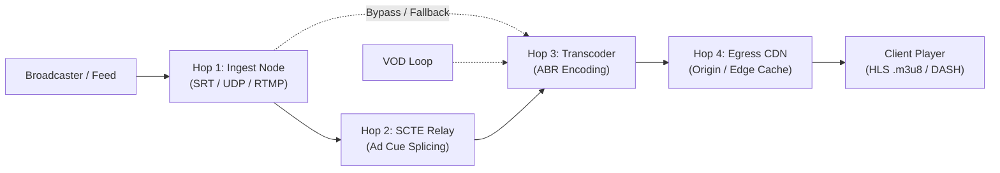

# Broadcaster to Client: End-to-End Data Travel Topology

This is a historical deployment routing reference for 14 channels, retained because
it contains operator-provided host/port mappings and unresolved topology questions.
It is **not** a live inventory or a hardcoded configuration file. Confirm addresses
with the operations team before using them. The current setup, architecture and
API documentation are in the [project README](../../README.md).

Create channels and probe targets through the **Add Stream** canvas. The running
Workspace and exported configuration reflect the actual saved topology.

---

## 1. Core Architecture Flow

Zyada-tar channels ka signal in 4 hops se guzarta hai (India Daily 24x7 jaise direct channels kam hops use karte hain):

---

## 2. Channel Master Routing Table

| Channel Name | Hop 1: Ingest Node | Hop 2: SCTE Relay | Hop 3: Transcoder | Hop 4: Egress CDN | Redundancy Status | Routing Architecture | Trigger ID |
|---|---|---|---|---|---|---|---|
| **ABN Andhrajyoty** | `live1.ottlive.co.in` | `148.113.16.234:63004` | `xcode2.ottlive.co.in` | `stream.ottlive.co.in` | Standard (Single Ingest) | Pull from SCTE and Live1 | `abn_andhrajyoty` |
| **Sakshi Tv** | `ingest3.ottlive.co.in` *(Backup: `ingest`)* | `multi.ottlive.co.in:63042` | `xcode3.ottlive.co.in` | `stream.ottlive.co.in` | Dual Ingest Failover | Pull from SCTE & ingest; Customer Backup | `sakshi_tv` |
| **Sandesh News** | `jio.ottlive.co.in:8289` *(Backup: `cloud:9898`)* | `multi.ottlive.co.in` | `xcode3.ottlive.co.in` | `stream.ottlive.co.in` | Dual Ingest Failover | Pull from SCTE & jio.ottlive.co.in | `sandesh_news` |
| **Gujarat first** | `cloud.ottlive.co.in:9898` *(Backup: `cloud:9898`)* | `148.113.16.234:63017` | `xcode2.ottlive.co.in` | `stream.ottlive.co.in` | Dual Ingest Failover | Pull from SCTE & cloud.ottlive; Customer Backup | `gujarat_first` |
| **Bharat 24** | `legitpro.co.in` | `148.113.6.240:63045` | `xcode2.ottlive.co.in` | `stream.ottlive.co.in` | Standard (Single Ingest) | Pull from SCTE, legit pro, ingest 1, vod | `bharat_24` |
| **News Tamil** | `distro.ottlive.co.in` | `148.113.6.240:63026` | `xcode2.ottlive.co.in` | `stream.ottlive.co.in` | Standard (Single Ingest) | Pull from SCTE, Distro.ottlive, Vod | `news_tamil` |
| **News Malayalam** | `jio.ottlive.co.in:8289` | `148.113.6.240:63027` / `148.113.16.234:63013` | `xcode4.ottlive.co.in:8289` | `stream.ottlive.co.in` | Dual SRT SCTE Redundancy | Dual SRT receive (latency=3000); pull from both SCTE & vod | `news_malayalam` |
| **Big Tv** | `distro.ottlive.co.in` | `148.113.6.240:63035` | `xcode2.ottlive.co.in` | `stream.ottlive.co.in` | Standard (Single Ingest) | Pull from SCTE & Vod | `big_tv` |
| **R Plus Gold** | `ingest1.ottlive.co.in` | `148.113.16.234:63053` | `xcode.ottlive.co.in` | `stream.ottlive.co.in` | Standard (Single Ingest) | Pull from SCTE & Vod | `r_plus_gold` |
| **NKR Tv** | `ingest.ottlive.co.in` | `multi.ottlive.co.in:63065` | `live1.ottlive.co.in` | `stream.ottlive.co.in` | Standard (Single Ingest) | Input coming from channel side, ingest 1 & vod; latency=200 | `nkr_tv` |
| **Kolkata Tv** | `xcode3.ottlive.co.in` *(Direct)* | `148.113.16.234:64031` | `xcode3.ottlive.co.in` | `stream.ottlive.co.in` | Standard (Direct Loop) | Pull from SCTE & Vod | `kolkata_tv` |
| **Mahaa Maxx** | `cloud.ottlive.co.in` | `148.113.16.234:63046` | `xcode3.ottlive.co.in` | `swifttv.ottlive.co.in` | Standard (Single Ingest) | Pull from SCTE & vod; Swifttv CDN Egress | `mahaa_maxx` |
| **Argus News** | `ingest.ottlive.co.in` *(Backup: `ingest1`)* | `multi.ottlive.co.in:63052` | `xcode3.ottlive.co.in` | `stream.ottlive.co.in` | Dual Ingest Failover | Pull from SCTE & Vod; Dedicated ingest1 backup | `argus_news` |
| **India Daily 24x7** | `live1.ottlive.co.in` | *Direct Ingest (No SCTE)* | *Direct Pass-Through* | `swifttv.ottlive.co.in` | Direct Origin Egress | Pull from customer end, server.livelegitpro & vod; Direct Swifttv | `india_daily_24x7` |

---

## 3. Server Node Categorization

Yahan physical/virtual nodes ka role-wise breakdown hai:

### Ingest Nodes (Hop 1)
- `live1.ottlive.co.in`
- `ingest.ottlive.co.in`, `ingest1.ottlive.co.in`, `ingest3.ottlive.co.in`
- `cloud.ottlive.co.in:9898`
- `jio.ottlive.co.in:8289`
- `distro.ottlive.co.in`
- `legitpro.co.in`

### SCTE Relay Nodes (Hop 2)
- Dedicated IP `148.113.16.234` (ports: 63004, 63017, 63013, 63053, 64031, 63046)
- Dedicated IP `148.113.6.240` (ports: 63045, 63026, 63027, 63035)
- `multi.ottlive.co.in` (ports: 63042, 63065, 63052)

### Transcoders (Hop 3)
- `xcode.ottlive.co.in`
- `xcode2.ottlive.co.in`
- `xcode3.ottlive.co.in`
- `xcode4.ottlive.co.in:8289`
- `live1.ottlive.co.in`

### Egress CDN / Origin (Hop 4)
- `stream.ottlive.co.in` (Primary HLS CDN)
- `swifttv.ottlive.co.in` (SwiftTV HLS CDN for Mahaa Maxx & India Daily 24x7)

---

## 4. Probe targets (kaise check hota hai)

Hop 1 (ingest) aur Hop 2 (SCTE relay) HLS nahi hain: ye SRT / UDP / RTMP feeds hain. Inhe `GET playlist.m3u8` se check nahi kar sakte. Isliye har hop ka probe user dashboard ke **Add Stream** canvas mein bharta hai. Ye MongoDB `pipeline_probe_targets` mein save hota hai aur agle round (10 s) se use hota hai, restart nahi chahiye. Probe types:

| Probe | Kis hop ke liye | Kya check hota hai |
|---|---|---|
| **HLS playlist** (URL) | Transcoder, CDN egress, HLS output dene wala koi bhi hop | Hop ek stream ban jaata hai (`pipeline:<channel>/<hop>`) aur normal stream flow use check karta hai: playlist + pehle media bytes, "2 lagatar fail" rule, ruki hui playlist |
| **TCP port** (`host:port`) | RTMP ingest ya koi TCP listener | Port connection accept karta hai ya nahi, "2 lagatar fail" rule |
| **Not probed** | UDP / SRT feeds, ya jinka URL abhi pata nahi | Hop **Not probed** dikhta hai: na root cause banta hai, na healthy maana jaata hai |

SRT host ping is shown separately as server reachability; it does not verify stream health.

Har hop ka **asli** URL ya host:port ops team se confirm karke hi bharein. Koi URL andaze se na likhein: galat URL har round mein galat root cause dega.

## 5. Data jo confirm karna baaki hai

Table ki ye entries ek-doosre se mel nahi khaatin. Config inhe jaisa-ka-taisa rakhta hai; inhe ops team se confirm karke table aur config dono theek karein:

| Channel | Kya mel nahi khaata |
|---|---|
| Gujarat first | Backup ingest (`cloud:9898`) primary jaisa hi hai: asal mein redundancy nahi hai. |
| Kolkata Tv | Ingest aur transcoder dono `xcode3.ottlive.co.in` hain. |
| NKR Tv | Transcoder `live1.ottlive.co.in` hai, jo ek ingest node hai. |
| Sandesh News | SCTE relay `multi.ottlive.co.in` ka port nahi diya. |
| Bharat 24 | "Standard (Single Ingest)" likha hai, par routing mein "legit pro, ingest 1" do sources hain. |
| India Daily 24x7 | Backup source sirf "server.livelegitpro" likha hai: pura host nahi. |
| Sabhi "Pull from … & Vod" channels | VOD source ka host kahin nahi likha. |
